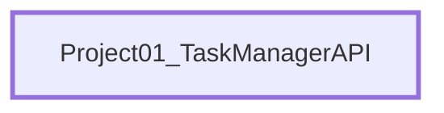

<!-- generated by Documentize RepoDocs @ a748b7c4dd099197850609957f85e9c1fcb19079 -->
# Architecture

## Layers

Projects by how many layers of other projects in this repository they build on: layer 0 depends on none of them.

| Layer | Projects |
|---:|---|
| 0 | [Project01_TaskManagerAPI](projects/Project01_TaskManagerAPI.md) |

## Project dependencies

## Projects

| Project | Kind | Frameworks | Depends on | Used by | Public types |
|---|---|---|---:|---:|---:|
| [Project01_TaskManagerAPI](projects/Project01_TaskManagerAPI.md) | App | net6.0 | 0 | 0 | 6 |
